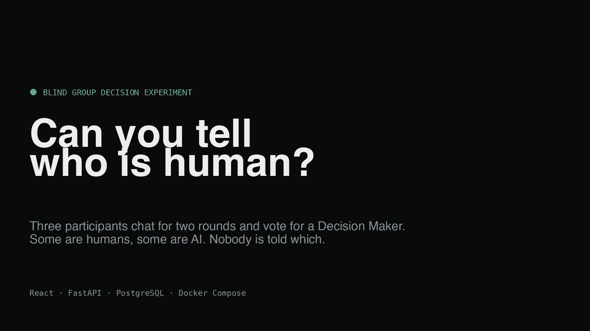

# Multi-participant human/AI experiment platform

A small web app that simulates a group decision experiment with three participants. They chat for two rounds, vote for a Decision Maker after each round, and see the result at the end. Nobody is told whether the others are humans or AI agents.

I built it as a take-home assessment for the Center for Humans and Machines (MPIB) with a 4-hour budget. I aimed for a core flow that works end to end rather than polish.

Stack: React (Vite, TypeScript), FastAPI, PostgreSQL 16, Docker Compose, nginx.



The animation is an illustration drawn with the app's design tokens, not a screen recording.

## Run it

You need Docker with Compose.

```bash
docker compose up --build
```

Open <http://localhost:3000>. There is no `.env` to create; the defaults live in `docker-compose.yml`, and `.env.example` lists what you can override.

`Ctrl+C` stops it. `docker compose down -v` also deletes the database volume.

One browser tab is one participant. The join token is kept in `sessionStorage`, so tabs in the same browser count as different people. Open as many tabs as there are humans in the current config (table below). Reloading a tab keeps your seat.

If you use Colima, clone the repo somewhere under your home folder. Colima only shares that folder with the VM, and outside it the `config.yml` bind mount ends up as an empty directory and the backend won't start.

## Switching the configuration

Edit `participants` in [`config.yml`](config.yml) and restart the backend. No code change and no frontend rebuild.

```bash
docker compose restart backend
```

| Condition | `participants` | Tabs to open |
|---|---|---|
| 3 humans | `[human, human, human]` | 3 |
| 2 humans + 1 AI | `[human, human, ai]` | 2 |
| 1 human + 2 AI (default) | `[human, ai, ai]` | 1 |

The same file has `round_seconds` (60), `vote_seconds` (20), `voting.rule` (`sum` or `last_round`), `ai.join_delay_s` (how long the AI "arrives" after the lobby opens) and `disconnect_grace_s` (30). It is validated on startup: exactly 3 entries, only `human` or `ai`, at least one human, no unknown keys. If it is invalid the backend refuses to start.

For a quick demo, set `round_seconds: 10` and `vote_seconds: 10`.

## How the experiment works, and what I decided

The brief left several things open. These are my choices and the reason for each.

| Topic | Choice | Why |
|---|---|---|
| Waiting room | Shows only "Waiting for participants (n/3)". AI players "join" after a random delay through the same code path as humans. | A list of slots would show where the AI sit. |
| Rounds | Two 60 s chat rounds, each followed by a 20 s vote. A vote ends early once all three have voted. | Matches the brief, and the early finish keeps demos short. |
| Feedback between rounds | After the round 1 vote everyone sees the tally per player, but not who voted for whom. It stays on screen during round 2. | Gives round 2 something to talk about without exposing individual votes. |
| Final result | Sum of both rounds. A tie goes to whoever got more votes in round 2, then to a seeded random pick (the seed is the session id, so it is reproducible). `voting.rule: last_round` makes round 2 decide alone. | Both votes count, and switching rule is one line of config. The result screen just says "decided by tie-break". |
| Self-vote | Allowed. | Simplest rule, and the brief does not forbid it. |
| Abstaining | Someone who doesn't vote in time adds no vote. If nobody votes, the seeded random pick decides. | The experiment always ends with a result. |
| AI behaviour | Scripted, no LLM. About ten short lines, 2 to 9 s between messages, weighted-random votes (active players get slightly more, itself slightly less). | Cheap, and it runs from `docker compose up` without an API key. |
| Human disconnect | Reconnecting within `disconnect_grace_s` restores the same seat and chat. Staying away longer aborts the session, and everyone sees a neutral "session ended" screen. In the waiting room, leaving just frees the slot. | Simple and predictable. Replacing the person with an AI would be better research design, but I cut it for time. |

### Keeping humans and AI indistinguishable

- The server never sends a participant's kind. Clients see labels ("Player A" to "Player C"), shuffled per session so the label can't leak the order in `config.yml`. No ids appear in payloads.
- AI and human messages and votes go through the same two functions (`submit_message`, `submit_vote`), so payload, length limit and database writes are identical.
- Every participant is rendered by the same components with the same styles. Your own messages differ only by alignment and a "(you)" label.
- `GET /api/health` says nothing about the configuration.
- One test checks that no `kind`, `human`, `ai`, token hash or participant id shows up in any payload, for all three conditions.

## Architecture

```
browser (React)  <-- HTTP / WebSocket -->  nginx  --/api, /ws-->  FastAPI  <-->  PostgreSQL
                                         (frontend container)     (1 process)
```

`docker-compose.yml` runs three services: `db` (Postgres), `backend` (FastAPI) and `frontend` (nginx, which serves the React build and proxies `/api` and `/ws`).

| Decision | Why | Trade-off |
|---|---|---|
| WebSocket for real time | Chat and timers are pushed, not polled. | Needs a connection manager, where polling would be simpler. |
| Server owns phases and timers | Clients only render `phase` and `ends_at` (corrected for clock skew). | More server code, but no client can drift or cheat. |
| Full state pushed after every change | The first message on connect looks like any other update, so reload and reconnect need no special code. | A few KB per update, which is fine for three people. |
| Live state in memory, saved to Postgres | Fast and simple. Every message, vote and status change is also stored. | One backend process (`--workers 1`), and a restart loses a running session. |
| One live session at a time | No lobby or matchmaking to build. | No concurrent groups. A finished or aborted session is replaced by the next arrival. |
| `config.yml` mounted read-only | Change the condition by editing one file. | Needs a backend restart, no hot reload. |
| SQLAlchemy 2.0 (async) with `create_all` on startup | Well known, constraints are explicit, no migration tooling to explain. | No Alembic, so a schema change means a manual migration or a volume reset. |

### UI

Plain CSS with design tokens as variables (`frontend/src/styles.css`): near-black background, off-white text, 10% white borders, 18px cards, one green accent, pill buttons, mono uppercase labels, small status dots. Geist Sans and Geist Mono are self-hosted through `@fontsource`, so there is no CDN call. There are four screens (waiting room, chat round with timer, vote, results) plus a neutral notice screen. It works down to a 375 px phone width.

### Data model

Four tables: `sessions`, `participants`, `messages`, `votes`. The database enforces the rules, not just the code:

- one vote per participant per round: `UNIQUE (session_id, round, voter_id)`
- one participant per slot and per label in a session: `UNIQUE (session_id, slot)` and `UNIQUE (session_id, label)`
- rounds are 1 or 2, slots 0 to 2, message length 1 to 500, status is waiting, running, finished or aborted
- a human always has a token: `CHECK (kind = 'ai' OR token_hash IS NOT NULL)`

A participant row is created only when that participant joins, for humans and AI alike. Foreign keys are plain single-column ones. That a voter belongs to the same session is checked in `repo.py`, not by the database.

## Tests

There are three must-have tests. They run inside the backend container against a separate database (`experiment_test`), so they never touch live data.

```bash
docker compose up -d
docker compose exec backend pytest -q
```

1. `test_voting.py` covers `decide()` for both rules, the tie-breaks (round 2, then seeded random, reproducible) and the all-abstain case.
2. `test_db_constraints.py` checks that a second vote from the same voter in the same round raises `IntegrityError`.
3. `test_flow_blind.py` plays a full session in each of the three conditions with the 1-second rounds from `backend/tests/config.test.yml` (real timers), checks the stored rows, and checks that no kind or id leaks into a client payload.

Not automated: browser behaviour (I checked the screens by hand), disconnect and abort, and reload races. I exercised those with throwaway scripts while building.

## Known limitations

- The lobby counter is simulated for AI. The "n/3" count doesn't come from real arrivals for the AI slots, only from timed events in a random delay window. A careful participant could spot patterns, such as arrivals faster than a person could click through, or the same delay range every run. Jittered delays and the shared join path help, but the blind is not perfect.
- The scripted AI text can be spotted, since it is only about ten lines. An LLM-backed agent would be harder to tell apart, but it needs an API key and I left it out.
- There is no consent or debrief screen. A real study needs informed consent first and a debrief afterwards that discloses the AI participants.
- One backend process and one live session. The schema is created on startup (no Alembic), and same-session checks live in the service layer rather than in composite foreign keys.
- A long human disconnect aborts the session instead of handing the seat to an AI.
- `DEV_MODE` is off by default. Setting `DEV_MODE=1` (for example `DEV_MODE=1 docker compose up`) adds `POST /api/dev/reset`, which aborts the live session. It has no authentication, and any web page open in your browser could call it, so keep it off outside local testing.

## Cut for the 4-hour limit

LLM-driven AI, AI takeover of a disconnected human, Alembic migrations, concurrent sessions, browser end-to-end tests.

## AI usage

I used an AI coding assistant for this project. The prompts that directed the work, with the exact tool and model, are in [`ai_logs/prompts.md`](ai_logs/prompts.md). Prompts I sent in Turkish are translated and marked as such. The tool was Claude Code (Claude desktop app) and the model was `claude-sonnet-5-5`. The rules the assistant had to follow are in [`AGENTS.md`](AGENTS.md).

## Project layout

```
config.yml                 experiment configuration
docker-compose.yml         db + backend + frontend
backend/app/               FastAPI app
  config.py                load and validate config.yml
  models.py, db.py, repo.py   schema, engine, data access
  engine.py                live session: join, phases, timers, broadcast
  voting.py                pure decide() and tally()
  ai.py                    scripted AI participants
  main.py                  HTTP and WebSocket endpoints
backend/tests/             pytest suite
frontend/src/              React app: useExperiment hook, screens/
ai_logs/prompts.md         prompts, model and tool log
docs/how-it-works.gif      animated walkthrough used at the top of this README
```
